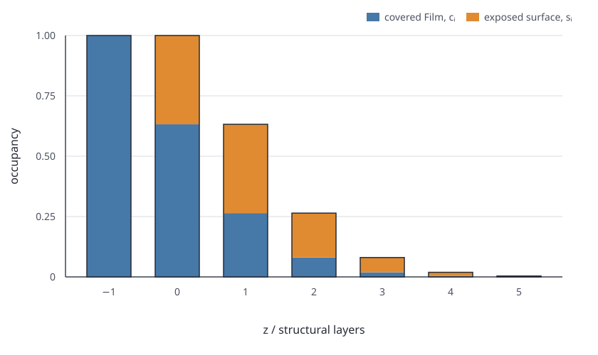
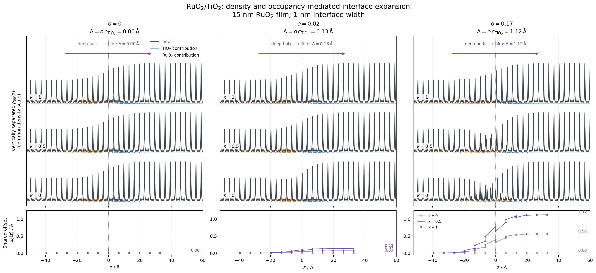

CTR Structure-Factor Normalization
==================================

The CTR calculation API uses canonical structure-factor units throughout:
every public ``F`` or ``F_uc`` method returns a complex scattering amplitude
in electrons.

.. warning::

   This convention changes amplitudes produced by older releases that divided
   unit-cell factors by area or volume. Legacy reference amplitudes and fitted
   experimental scale factors must be migrated by the corresponding constant
   normalization factor. Intensities change by the square of that factor.

CTR NeXus angle and index persistence
----------------------------------------

``CTR.toNXdict`` writes the independent H, K, and L arrays in reference-cell
r.l.u. and the six-circle angle arrays in radians. New payloads carry
``@orgui_ctr_schema=2`` and ``sixc_angles/@unit="rad"``. The loader preserves
each angle column for any number of scan points.

``CTR.fromNXdict(payload, angle_units=None)`` reads the declared angle unit
from versioned payloads. For unversioned payloads, the default preserves
numeric angles as radians, because historical orGUI writers incorrectly
labeled their radian data as degrees. To load genuine external degree-valued
data, use ``angle_units="deg"`` explicitly; ``angle_units="rad"`` also provides
an explicit override. ``CTRCollection.fromNXdict`` forwards this option to
every rod. Unit overrides take precedence over stored labels, and conversions
apply only to the six-circle angles, not the structure-factor phase.

Historical writers also copied H into the K array. The loader preserves the
stored K values: there is no generally reliable way to reconstruct the
original K without independent index information. Correct those files using
trustworthy source metadata before scientific analysis.

Measurement quantity, polarization, and scan metadata
------------------------------------------------------

The :doc:`ctr_data_workflow` tutorial demonstrates the preferred loading and
plotting API, NeXus persistence, and explicit migration of legacy ANAROD data.

For new text datasets, use the one-line loader
``CTRCollection.fromCTRFile(path)``. The ``.ctr`` format keeps the useful
ANAROD-style whitespace-separated H, K, L, value, and uncertainty columns but
omits the unused mode column. Leading ``# key: value`` lines declare schema 2,
the stored quantity, polarization state, and column names. An optional trailing
``polarization_factor`` column is retained point by point and split with each
rod. Legacy ANAROD files remain the responsibility of
``CTRCollection.fromANAROD``; the new loader rejects them rather than guessing
missing reduction metadata.

Each ``CTR`` owns a frozen ``MeasurementReduction``. Its ``quantity`` is the
sole definition of what ``CTR.sfI`` and ``CTR.err`` contain:

* ``"structure_factor"`` stores F and its uncertainty in the existing
  arbitrary structure-factor units;
* ``"reflectivity"`` stores the corrected dimensionless field-intensity ratio
  R and its absolute uncertainty.

Legacy constructors and files without this metadata default to structure
factor with unknown polarization provenance. New measurements can record the
incident mixture and outgoing analysis explicitly:

.. code-block:: python

   import numpy as np
   from orgui.datautils.xrayutils.CTRplotutil import (
       CTR,
       CTRScanGeometry,
       MeasurementReduction,
       PolarizationReduction,
   )

   reduction = MeasurementReduction(
       quantity="structure_factor",
       polarization=PolarizationReduction(
           s_fraction=0.7,
           outgoing="unanalysed",
           polarization_factor=np.asarray([0.98, 0.97, 0.96]),
       ),
   )
   rod = CTR(
       (1, 0),
       l,
       F,
       sigma_F,
       reduction=reduction,
       scan_geometry=CTRScanGeometry(
           fixed="in", angle=np.deg2rad(0.3), mirrorx=False
       ),
   )

``s_fraction`` is the incoherent incident s fraction in the local Renaud
basis: one is pure s and zero is pure p. ``outgoing`` is ``"s"``, ``"p"``,
or ``"unanalysed"``. For structure-factor data,
``polarization_factor`` stores the conventional pointwise intensity factor P,
not its reciprocal. ``None`` records P=1. A supplied factor must be finite,
strictly positive, and aligned with the CTR points. Reflectivity cannot carry
this factor because stored R must already contain the selected experimental
correction.

``CTRScanGeometry`` records only the z-mode scan rule. Fixed incidence or exit
uses ``fixed="in"`` or ``"out"`` and an angle in radians in
``(0, pi/2]``. Equal-angle scans use ``fixed="eq", angle=None``. ``mirrorx``
selects the negative-delta scattering branch. Stored six-circle angle records
remain the measured central geometry; the scan rule does not replace them.

Schema-2 NeXus output preserves both metadata records and stores P as a
pointwise dataset. Existing schema-2 payloads that predate these fields still
load with the legacy defaults. ``CTR.fromArray`` and both ANAROD import paths
accept ``reduction=`` and ``scan_geometry=`` overrides.

Copying and point selection preserve the metadata, applying cuts to P and the
six-circle records together with the values and errors. Geometry- or
reduction-aware binning is not defined yet and raises instead of independently
averaging quantities that do not preserve the measurement equation. Existing
kinematical fitting and crystal scaling, difference calculations, collection
scaling, structure-factor resolution convolution, phase/complex-F operations,
ANAROD F export, and symmetry averaging reject reflectivity explicitly. Plot
panels select labels from the stored quantity and F/R datasets cannot share one
axis.

Converting between the two quantities is a question of scale, not of data
handling: Vlieg (1997) equation (63) relates them by

.. math::

   R = \frac{r_e^2\lambda^2 P_r}
            {A_u^2\,\sin\alpha\,\sin\beta_\mathrm{out}}\,|F_{hkl}|^2 ,

with :math:`A_u` the surface unit-cell area and
:math:`\alpha`, :math:`\beta_\mathrm{out}` the incidence and exit angles that
``CTRScanGeometry`` already records.
:func:`orgui.datautils.xrayutils.corrections.measurement.structure_factor_from_reflectivity`
and its inverse implement it, so an absolutely scaled reflectivity curve and a
set of truncation rods can be brought onto one scale before they are combined.
The relation is kinematical: it does not hold near a bulk Bragg peak, nor below
the critical angle, where the distorted-wave treatment of :doc:`dwba` applies.

Total-incident-flux measurement contract
----------------------------------------

The correction core and both integration paths provide an explicit alternative
to the legacy peak-flux-density times effective-area convention. New sessions
default to a relative total-flux contract; calibrated output is opt-in and is
labeled separately. Legacy saved configurations retain their old numerical
meaning. This compatibility normalization is deprecated and scheduled for
removal, warns when used, and is no longer selectable in the GUI. Imported
settings remain unchanged until a total-flux mode is explicitly selected.

``corrections.normalization.frame_fluence`` calculates incident photons
:math:`Q_f` in a frame. A rate-like monitor is multiplied by that frame's
exposure; an integrated monitor is not, because its reading already contains
the exposure. The monitor kind and its calibration reference are mandatory
rather than inferred from a counter name. The uncalibrated
``relative_frame_fluence`` helper follows the same exposure rule while keeping
the output on a relative scale.

For a normalized vertical beam profile, incidence angle :math:`\alpha` in
radians and sample length :math:`L` in metres,
``corrections.activearea.illumination_divisor`` returns

.. math::

   H = \frac{f_z f_x}{\sin\alpha},

where :math:`f_z` is the vertical beam fraction on the sample and :math:`f_x`
is an explicitly supplied horizontal intercepted fraction. ``H`` is
dimensionless. It is not the fraction of photons that hit the sample; that
fraction is :math:`f_\mathrm{hit}=f_zf_x`. Built-in profiles evaluate the
finite grazing-incidence limit without clipping the angle.

Given a background-subtracted photon-normalized yield
:math:`Y=N_\mathrm{net}/(Q_f H)`, the pair
``measurement.structure_factor_squared_from_photon_yield`` and
``measurement.photon_yield_from_structure_factor`` applies the existing scan-
mode angular factor and the total-flux prefactor
:math:`K=r_e^2\lambda^2/A_u^2`. Wavelength is in Angstrom and surface
unit-cell area in square Angstrom. Existing ``scale_factor`` and
``structure_factor_squared`` calls keep their flux-density semantics.

The integration dialog stores the exact :math:`Q_f` and :math:`H` arrays used
for every extracted curve, together with applied/not-applied status, monitor
kind and units, beam-profile provenance, detector-arm/ROI geometry and the
scale convention. A rocking reduction always reconstructs from the immutable
polarization-only base curve before applying these divisors; keep, remove and
replace actions therefore cannot compound a correction. Unknown legacy
provenance is rejected rather than guessed.

For calibrated total flux, stationary and rocking results additionally divide
by :math:`K`. Detector efficiency and external transmission are currently
explicit unity assumptions. The numerical contract has an independent
finite-width Gaussian-rod forward test evaluated on calibrated detector rays.
It varies flux, exposure, rate-like/integrated monitors, beam width/offset,
detector arms and ROI clipping, and establishes rocking-grid convergence
before setting tolerances. A finite or clipped ROI is compared with its
resolution-weighted :math:`|F|^2` integral, not with an unrelated point value.

No distributable raw CTR scan with independently calibrated incident flux is
present in the repository. Consequently this validation establishes the
implemented numerical contract but not beamline-specific absolute accuracy.
That still requires a real standard measurement, detector efficiency and
external transmission, and characterization of the in-plane acceptance
:math:`C_\mathrm{det}` when the ROI does not contain the complete peak.

.. _ctr-fitting:

Fitting CTR measurements
------------------------

``CTROptimizer`` connects a crystal model and a measured ``CTRCollection`` to
prediction, residual, and statistics methods. It prepares the fit problem;
a numerical solver such as SciPy's ``least_squares`` searches the selected
structural parameters. The :doc:`ctr_data_workflow` tutorial provides complete
examples for structure-factor data and absolute reflectivity.

Define the model and fitted parameters
^^^^^^^^^^^^^^^^^^^^^^^^^^^^^^^^^^^^^^

Start with a configured ``SXRDCrystal`` and reduced measurements with known
quantity metadata. H, K, and L are reference-cell reciprocal lattice units;
``sfI`` contains F amplitudes or dimensionless corrected R, as declared by
``ctr.reduction.quantity``. Supply finite, point-aligned observations and
strictly positive uncertainties in the same units as those observations.

Select the structural parameters and bounds on the model before constructing
the optimizer. For example, if the first two atoms of a surface ``UnitCell``
form its terminating plane, this registers one shared fractional-z parameter:

.. code-block:: python

   surface.addFitParameter(
       ([0, 1], ["z", "z"]),
       limits=(-0.03, 0.04),
       name="surface_expansion",
   )

The bounds here are fractional cell coordinates, not Angstrom. Choose them
for the actual model; other atomic parameters retain their own documented
units. Crystal-level ``addFitParameter`` can couple parameters across named
components, and :doc:`wyckoff_fitting` covers symmetry-aware parameter binding.
Unselected model parameters remain fixed.

The optimizer deep-copies both the model and measurements. Changes made later
to the originals do not change the fit; use ``optimizer.model`` for the fitted
model and ``optimizer.xtal`` for its coherent crystal. These are the
same object for an ordinary ``SXRDCrystal``; an incoherent model wrapper owns
the coherent crystal separately.

Choose the scattering calculation and scale policy
^^^^^^^^^^^^^^^^^^^^^^^^^^^^^^^^^^^^^^^^^^^^^^^^^^^^^^^

The default scattering calculation is kinematical and accepts F datasets only.
For R data, mixed F/R collections, or distorted-wave calculations, enable
``optimizer.set_dwba()`` before preparation and provide the measurement
geometry and polarization described in :ref:`dwba-fitting`.

By default, every F rod has its own positive analytical scale
(``"F": "scaled"``), including a specular F rod, while R remains on its
absolute scale with multiplier one (``"R": "fixed"``). The declared quantity
determines these defaults; the indices ``(0, 0)`` do not imply reflectivity.

Each rod resolves to one of three policies:

* ``"fixed"`` multiplies the prediction by one. Use it when the model and
  measurement already share an absolute scale.
* ``"scaled"`` determines an independent multiplier for each selected rod.
* ``"global"`` determines one shared multiplier for all rods assigned to the
  global group. That group must contain only F or only R; combining both
  quantities in one global group raises ``ValueError``.

For unscaled prediction :math:`m_i`, observation :math:`y_i`, supplied
uncertainty :math:`\sigma_i`, and rod weight :math:`w_i`, the fitted scale is

.. math::

   a = \frac{\sum_i w_i m_i y_i / \sigma_i^2}
            {\sum_i w_i m_i^2 / \sigma_i^2}.

The sums cover one rod for ``"scaled"`` or the complete global group for
``"global"``. The scale multiplies the prediction in the stored F or R
representation; observations and uncertainties are preserved. It is
recalculated at every model evaluation rather than added to the numerical
parameter vector. A zero prediction norm or a nonpositive/nonfinite fitted
scale is invalid, so select physically meaningful starting parameters.

The constructor accepts ``scale_policy={...}``, and
``set_scale_policies({...})`` partially updates the current configuration.
``"F"`` and ``"R"`` keys select quantity defaults; rod identifiers select
overrides, which take precedence over those defaults. For example:

.. code-block:: python

   optimizer.set_scale_policies({"F": "global"})
   rod_id = optimizer.CTRs[0].ctr_id
   optimizer.set_scale_policy(rod_id, "fixed")
   policies = optimizer.get_scale_policy()  # complete configuration
   selected_policy = optimizer.get_scale_policy(rod_id)

Use a rod's full ``ctr_id`` when multiple datasets have the same h and k.
The shorthand ``(h, k)`` is accepted only when it identifies exactly one rod.
An override affects that dataset alone; it does not rescale the observations
or change the other quantity's default.

Prepare, minimize, and inspect
^^^^^^^^^^^^^^^^^^^^^^^^^^^^^^

With ``model`` already configured and at least one fitted parameter selected,
a basic kinematical F fit is:

.. code-block:: python

   from scipy.optimize import least_squares
   from orgui.datautils.xrayutils.CTRopt import CTROptimizer
   from orgui.datautils.xrayutils.CTRplotutil import CTRCollection

   measured_ctrs = CTRCollection.fromCTRFile("sample.ctr")
   optimizer = CTROptimizer(model, measured_ctrs)
   optimizer.prepareFit()
   result = least_squares(
       optimizer.weighted_residues,
       optimizer.get_parameters().copy(),
       bounds=optimizer.get_bounds(),
   )
   prediction = optimizer.flat_prediction(result.x)
   diagnostics = optimizer.statistics(result.x)
   fitted_model = optimizer.model

Check the solver's ``result.success`` and ``result.message`` along with the
predicted curves and residuals. ``weighted_residues`` returns
:math:`\sqrt{w_i}(y_i-a m_i)/\sigma_i`; least squares minimizes their squared
sum. Rod weights are empirical objective weights, not replacement measurement
uncertainties. This example uses bound constraints only; it does not enforce
optional displacement inequality constraints.

``fitparnames``, ``get_parameters()``, and ``get_bounds()`` describe the
prepared numerical vector in the same order. ``n_parameters`` is its length;
analytical scales are counted separately in the statistical degrees of freedom.
If no numerical parameters are selected, use ``prepareFit()`` and the
prediction/statistics methods directly without calling ``least_squares``.

Prediction and statistics contract
^^^^^^^^^^^^^^^^^^^^^^^^^^^^^^^^^^

Constructing a ``CTROptimizer`` does not evaluate the model. Call
``prepareFit()`` after defining fitted parameters, callbacks, resolution-width
parameters, or displacement constraints. Prediction, residual, likelihood,
and statistics methods reject an unprepared layout with a message directing
the caller back to ``prepareFit()``. Fixed scale-policy and resolution-model
changes only invalidate the current result; the next evaluation refreshes it.

``flat_prediction(x=None, specular=True)`` is the quantity-neutral flattened
prediction API. It returns the final model values after analytical scaling, in
the same rod and point order as the stored data. ``flat_Fcalc`` remains the
F-only spelling and rejects a collection containing reflectivity. The public
``calculated_CTRs`` collection carries the same final prediction arrays and no
copied observation uncertainties. ``Rfactor`` selects only F data and
``Rfactor_R`` selects only R data; a quantity absent from the collection
returns ``None`` without warning.

The built-in kinematical optimizer still accepts structure-factor data only.
These quantity-aware outputs also define the common result contract used by
models that can predict reflectivity.

Call ``optimizer.set_dwba()`` to opt into live DWBA predictions. In that mode,
each rod's polarization reduction and measured six-circle records or z-mode
scan rule determine the field-intensity calculation. Structure-factor rods
receive an effective F prediction using their conventional pointwise P;
corrected-reflectivity rods receive direct R. Stored observations and errors
are never converted between these representations. The complete geometry,
polarization, bulk, and limitation contract is documented in
:ref:`the DWBA fitting section <dwba-fitting>`.

Analytical scale policies are configured explicitly:

.. code-block:: python

   optimizer.set_scale_policies({
       "F": "global",       # one scale shared by the default F group
       (0, 0): "fixed",      # use full ctr_id when hk is ambiguous
   })
   optimizer.prepareFit()
   prediction = optimizer.flat_prediction()
   diagnostics = optimizer.statistics()

``"fixed"`` uses a multiplier of one, ``"scaled"`` fits one analytical scale
per selected rod, and ``"global"`` fits one scale for the nonempty global
group. Analytical scales count as fitted parameters in the reported degrees
of freedom. ``statistics()["covariance"]`` is scaled by the reduced
chi-square, so its diagonal square root equals the reported parameter errors.
When the degrees of freedom are nonpositive or the local covariance is not
estimable, the unavailable statistics and parameter errors are ``None`` and a
warning is emitted. Raw chi-square and the available F/R diagnostics remain
reported. The p-value retains the existing chi-square interpretation and is
therefore heuristic when empirical per-rod weights differ from one.

As an example of a specialized subclass, ``CTROptAngleCorrection`` adds an
optional empirical sinusoidal correction based on measured omega, with fitted
phase and amplitude when ``useAnglecorr=True``. It is a kinematical extension
of ``CTROptimizer`` and does not support DWBA fitting.

Signed intensity-to-amplitude conversion
----------------------------------------

``CTR.convertToF()`` converts an intensity in arbitrary F-squared units to a
signed amplitude in place:

.. math::

   g(I) = \operatorname{sign}(I)\sqrt{|I|}.

Negative and zero measurements are retained, and the original intensity is
recoverable as ``g(I) * abs(g(I))``. This signed representation is not a phase
or an unbiased physical amplitude estimate. The conversion adds no
normalization or reflectivity-to-structure-factor physics, and therefore
rejects reflectivity-tagged datasets. Make a deep copy first if the original
intensity arrays are also needed.

For a finite input uncertainty :math:`\sigma_I > 0`, the existing ``err``
array is replaced by the effective symmetric interval half-width

.. math::

   \sigma_{F,\mathrm{eff}}
   = \frac{g(I + \sigma_I) - g(I - \sigma_I)}{2}.

This convention is finite at zero,
:math:`\sigma_{F,\mathrm{eff}}(0)=\sqrt{\sigma_I}`, and approaches ordinary
first-order propagation at high signal-to-noise. It summarizes the transformed
interval around the unchanged central value ``g(I)``; it does not make the
near-zero distribution exactly Normal. The implementation avoids subtracting
nearly equal roots for strong measurements. Invalid uncertainties raise before
the CTR is modified.

By default, nonfinite central intensities are removed while all finite signed
points remain aligned with L, polarization factors, angles, and other
pointwise fields. Pass ``excludeInvalid=False`` to preserve the historical
choice of retaining nonfinite points. Auxiliary ``bgI`` and ``ctrI`` intensity
counters receive the same signed-square-root mapping. The collection method
forwards the option and converts each member in place.

Unit-cell amplitudes
--------------------

``UnitCell.F_uc`` returns

.. math::

   F_{\mathrm{uc}}(\mathbf{Q})
   = c_{\mathrm{uc}} \sum_i o_i f_i(\mathbf{Q})
     \exp\left(i\mathbf{Q}\cdot\mathbf{r}_i\right),

including coherent-domain occupancies and displacement factors. No unit-cell
area or volume normalization is applied.

``Film.F_uc`` and ``PoissonSurface.F_uc`` sum their generated layer amplitudes
and return electrons for one lateral unit cell of their source
``UnitCell``.

Crystallinity
-------------

``UnitCell.crystallinity`` is a dimensionless coherent amplitude fraction
between zero and one, defaulting to one. It multiplies kinematic unit-cell
and bulk amplitudes once unless a structural layer overrides it. An isolated
contribution's intensity therefore scales with its square; interference with other components remains coherent.
This parameter does not model diffuse scattering or an incoherent crystalline
volume fraction.

Crystallinity leaves atomic occupancies, physical density helpers
(``zDensity_G`` and ``zDensity_G_asbulk``), and optical profiles unchanged.
In DWBA the reference index :math:`n_0(z)`, absorption, distorted fields, and
reference reflection amplitude remain fixed. For each generated material
record :math:`u`, the contrast is

.. math::

   \Delta\rho_u(c_u) = c_u(\rho_u^{\mathrm{at}}-\bar\rho_u),
   \qquad
   F_{\mathbf h,u}(c_u)
   = c_u\left(A_u-R_u\right).

Here :math:`A_u` and :math:`R_u` are the crystalline atomic and planar-reference
matrix elements under the same wavefields. DWBA diagnostics report
``F_atomic`` as the effective density amplitude
:math:`c_u A_u+(1-c_u)R_u`, and ``F_reference`` as the unchanged :math:`R_u`.
Their difference remains ``F_h``. At zero crystallinity that record has no
contrast, while its optical contribution remains present. The specular
reference reflection and any other crystalline components still scatter.

Set the property on the source material cell, or register it for fitting:

.. code-block:: python

   film_cell.crystallinity = 0.7
   film_cell.addCrystallinityParameter(
       name="film_order", limits=(0.0, 1.0)
   )

Use structural-layer overrides when order varies within a cell:

.. code-block:: python

   film_cell.setLayerCrystallinity(2, 0.3)
   film_cell.addCrystallinityParameter(layer=2, name="layer_2_order")
   film_cell.getLayerCrystallinity(2)  # 0.3, replacing the cell default
   film_cell.setLayerCrystallinity(2, None)  # resume the default/inherited value

``layer_crystallinity`` returns a copy of the explicit overrides;
``crystallinity_layers`` lists the available structural order IDs. These are
independent of optical slab discretization. Both atomic and reference matrix
elements are weighted by the same layer value:

.. math::

   F_{\mathbf h,u} = \sum_j c_{u,j}(A_{u,j}-R_{u,j}).

The reported ``F_reference`` remains :math:`\sum_j R_{u,j}` and
``F_atomic`` is :math:`\sum_j[c_{u,j}A_{u,j}+(1-c_{u,j})R_{u,j}]`.
The frozen reference retains each structural layer's density share, including
when several contributions share one optical medium. Changing layer order
reuses prepared wavefields, including inside a DWBA fit batch.

Generated Film and interface layers follow their source cell live, including
after deep copying a model for fitting. Poisson surface terminations follow
the supplied surface cell, or their individual cells in an explicit
termination bank. Use separate source cells to fit the film and interface
independently; sharing a source cell also shares its crystallinity.

Replacement and etching subtract material with the crystallinity of the
underlying source, independently of the crystallinity of the added material:

.. math::

   \Delta F = c_{\mathrm{added}}D_{\mathrm{added}}
              -c_{\mathrm{removed}}D_{\mathrm{removed}}.

Without overrides, zero crystallinity of a surface termination suppresses the
entire exposed slab represented by that cell. A layer override changes only
that structural group's contrast. Layer order IDs follow the atoms through
layered translations and are retained when ``as_surface_termination`` collapses
the stacking labels; inspect ``crystallinity_layers`` on the source slab.
Generated termination banks inherit subsequent source-layer edits live.
Supercells assign order IDs to their repeated structural layers. Signed
records from independently ordered materials remain separate even when their
atomic structures are identical.

Whole-cell terminations retain their physical internal optical planes separately
from the collapsed stacking selector. Each group contributes its own planar
forward-scattering inventory in electrons per square Angstrom, including the
absorptive part. When strain or coincident-plane merging changes the assembled
slab widths, the reference density is normalized to those widths to conserve
that inventory. The same construction supplies the crystal optical profile and
the frozen DWBA group shares. Consequently, replacing ordered material by its
planar reference conserves the group's electron content.

Native ``.xtal`` and ``.xpr`` files store ``optical_plane:`` records containing
the order-group ID, fractional origin and fractional thickness. Older saved
terminations with surviving ``crystallinity_layers:`` labels recover internal
origins from the groups' mean atomic z coordinates. If the original structural
origins differed from those means, regenerate the termination bank from its
source cell. Models that lost both the internal labels and the optical metadata
also require regeneration. Earlier DWBA fits using collapsed multi-plane
references need reevaluation; their fitted crystallinity values cannot be
assumed to represent mass-conserving conversion fractions. The atomic kinematic
structure-factor convention is unchanged by this optical correction.

Native text models store a ``crystallinity:`` line per cell, optional
``layer_crystallinity:`` overrides, and ``crystallinity_layers:`` atom labels
when needed to preserve transformed or collapsed groups. Fit-settings
dictionaries and HDF5 files also preserve the default, layer overrides and fit
parameters, bounds, and uncertainty. Older models without this field load with
crystallinity one. ``clearParameters()`` removes the fit definition while
retaining the current crystallinity value.

Independent order and occupancy profiles
^^^^^^^^^^^^^^^^^^^^^^^^^^^^^^^^^^^^^^^^

``PoissonSurface`` and ``EpitaxyInterface`` can also own independent
``CrystallinityProfile`` objects. The existing probability distribution still
sets material occupancy. The added profile sets coherent order as a function
of depth from the **local** surface or interface boundary. Both profiles can
therefore coexist and be fitted independently.

For a surface whose top occupied structural layer is :math:`H`, a film layer
:math:`j` has local depth :math:`d=H-j`. Its material and coherent weights are

.. math::

   p_j = \sum_H P(H)\,\mathbf{1}_{j\leq H}, \qquad
   w_j = \sum_H P(H)\,\mathbf{1}_{j\leq H}\,C(H-j).

Occupancy is counted once. Order applies only to the material present in
each terrace state; the final amplitudes are averaged over those states.
Within an exposed termination slab, depth counts its internal structural
layers down from the top. The same recovery continues into the immediately
underlying ``Film``. Bulk and other stack components retain their own order.
Flat-height states used for incoherent intensity averaging carry this same
local-depth profile.

The profile is a cumulative distribution of recovery depths:

.. math::

   C(d)=c_{\min}+(1-c_{\min})P(D\leq d-d_0).

``minimum`` is a dimensionless amplitude fraction; depth zero is the first
occupied structural layer beside the local boundary. Poisson parameters and
``depth_offset`` use structural-layer counts. Skellam ``width`` retains its
existing unit-cell convention, converted using the host's layer count.
For example, deterministic recovery at depth two suppresses the first two
layers and recovers at the third. The result multiplies each material's
existing cell or layer crystallinity. Optical density and :math:`n_0` stay
unchanged.

.. code-block:: python

   from orgui.datautils.xrayutils.CTRcalc import CrystallinityProfile
   from orgui.datautils.xrayutils.CTRdistributions import PoissonProfile

   # surface.profile continues to control the distribution of terrace heights.
   order = surface.setCrystallinityProfile(
       CrystallinityProfile(PoissonProfile(2.0, alpha=0.5), minimum=0.2)
   )
   order.addFitParameter("mean_change", name="disorder_depth", limits=(0, 5))
   order.addFitParameter("minimum", name="surface_order", limits=(0, 1))

The setter copies the supplied object and returns the owned profile. For
an interface, use ``side="top"`` and ``side="bottom"`` to attach independent
profiles on either side of the same fluctuating boundary. Depth increases
away from that boundary into each material. Use distinct fit names for
independent parameters; the existing shared-name fitting convention still
applies. Passing ``None`` detaches a profile.

Interface recovery must reach unity, within the distribution tail tolerance,
before the represented interface support ends. Choose ``fixed_ucs`` large
enough for the entire intended fitting range; a profile that exceeds this
support raises ``ValueError`` instead of silently truncating the disorder.
Height/boundary sums use the occupancy distribution's retained support and
tail tolerance. Adding or removing a profile changes DWBA record layout and
requires preparing again. Changing its fitted values within the supported
range can reuse the frozen optical fields.

Text models save ``crystallinity_profiles:`` metadata. HDF5 companions also
preserve fit parameters, bounds and uncertainties. Models without the new
metadata retain their existing amplitudes.

Semi-infinite bulk amplitude
-----------------------------

``UnitCell.F_bulk`` sums ``UnitCell.F_uc_bulk_direct`` over an infinite stack
of downward crystal repeats using a closed-form
geometric series with attenuation:

.. math::

   F_{\mathrm{bulk}}(\mathbf{Q})
   = \frac{F_{\mathrm{uc,bulk}}(\mathbf{Q})}
     {1 - \exp\left(-i\mathbf{Q}\cdot\mathbf{T} - \eta\right)},

Here :math:`\mathbf{T}` is ``UnitCell.repeat_cartesian`` in Angstrom and
:math:`\mathbf{Q}` is in inverse Angstrom. ``atten`` is the empirical,
dimensionless amplitude-decay exponent per reference-cell out-of-plane repeat;
:math:`\eta` is its conversion to this bulk repeat, using
``atten * abs(refHKLTransform[2, 2])``. The
:doc:`RuO2/TiO2 kinematical-attenuation tutorial
<dwba/kinematic_attenuation>` shows how to derive it from the DWBA
wavevectors at fixed incidence and how to determine the corresponding
minimum reliable exit angle and :math:`L` range.

For ``stacking_translation=(sx, sy, 1)``, the repeat phase is
:math:`2\pi(h_{\mathrm{bulk}}s_x+k_{\mathrm{bulk}}s_y+l_{\mathrm{bulk}})`.
These reciprocal indices are obtained *after* conversion from the reference
unit cell via ``refHKLTransform @ (h, k, l)``. With the legacy default
``(0, 0, 1)``, the phase reduces to :math:`2\pi l_{\mathrm{bulk}}`.
The same coordinate transform phases the motif, so basis conversion and the
repeat phase are each applied once.

Perpendicular surface cells
---------------------------

Miller-based ``CTRsymmetry.surface_terminations`` now uses a perpendicular
coordinate c and a separate physical repeat. See :doc:`wyckoff_fitting` for
construction, matrix input, and migration of reciprocal indices. Films,
supercells, layered translations, interfaces, Poisson height states, real-space
copies, Fourier density profiles, and DWBA use this repeat's lateral registry.
Normal-only strain stretches its normal component; a rigid normal gap does not
advance lateral registry. Stack layout passes registry separately from height.
A Poisson component passes its nominal mean registry to a component above it,
consistent with its existing mean-height convention; it does not propagate a
separate upper stack for every roughness realization.

Native unit-cell text files preserve ``stacking_translation`` and the original
bulk transform. Legacy files default to vertical repeats. ROD/SUR export rejects
nonvertical repeats because that format cannot preserve the separate state.
For kinematic ``F_bulk`` with a nonvertical repeat, coherent domains must
preserve that vector; transformations requiring different bulk repeats raise
an error and should be represented by separate bulk cells. Existing vertical
bulk-domain conventions remain unchanged.

This implements crystal stacking geometry. It does not infer terrace widths,
miscut angle, or coherence from a CIF, or introduce new roughness statistics.

.. warning::

   Versions up to and including v1.5.0 used the raw, untransformed ``l`` in
   this denominator instead of the reference-transformed index. This was only
   correct when ``refHKLTransform``'s third row equals ``(0, 0, 1)``, i.e.
   only when the bulk cell's own out-of-plane reciprocal axis exactly
   coincides with the reference cell's, in both direction and length. Since
   ``refHKLTransform = B_mat_inv @ rotMatrix @ uc.B_mat`` (see
   ``UnitCell.setReferenceUnitCell``), this held only for the default case of
   a component using its own bulk cell as the reference (no ``reference_uc``
   set). Any explicit ``reference_uc`` whose out-of-plane reciprocal axis
   differs from the bulk's was affected — including a plain scale difference
   between the reference and bulk out-of-plane axis length, not only a
   rotated or reindexed reference.

Distorted-wave Born approximation
----------------------------------

The DWBA calculation, observable-amplitude conventions, comparison with the
kinematical CTR, and worked RuO2/TiO2 tutorial are documented in
:doc:`dwba`.

Surface structure on a rough Film
---------------------------------

A ``PoissonSurface`` is stacked immediately above a ``Film`` and replaces the
Film structure only on the fraction that is truly exposed.  Let
:math:`\theta_i` be the cumulative material occupancy of structural layer
:math:`i`, ordered from bottom to top.  Its exposed surface occupancy is

.. math::

   s_i = \theta_i - \theta_{i+1},

where the occupancy above the highest represented layer is set to zero.  The
part of layer :math:`i` that is covered by another layer remains Film material
with occupancy

.. math::

   c_i = \theta_i - s_i.

The sharp Film already supplies occupancy :math:`\chi_{i<0}` below its nominal
boundary.  Before applying a reconstructed surface structure,
``PoissonSurface`` adds the rough-Film correction

.. math::

   \Delta F_{\mathrm{rough}}
   = \sum_i \left(\theta_i-\chi_{i<0}\right)F_{\mathrm{Film},i}.

The exposed fraction is subsequently replaced by a termination-specific
surface slab as described below.  Film and surface structures can consequently
occur at the same terrace height on complementary lateral fractions.

   Occupancy decomposition for ``PoissonProfile(mean_change=2, alpha=0.5)``.
   Each bar has total height :math:`\theta_i`; its orange segment is the true
   surface fraction :math:`s_i`, and its blue segment is covered Film
   :math:`c_i`.

Termination-specific relaxed surface slabs
-------------------------------------------

A reconstructed surface generally does not repeat the bulk layer cycle.  The
``layer`` column therefore has a narrower meaning for a surface slab: it
selects the Film termination to which the *complete slab* belongs.  Internal
planes of that slab are distinguished by their z coordinates, not by cycling
layer identifiers.  ``UnitCell.as_surface_termination`` makes this explicit by
assigning one termination identifier to every atom and setting
``layer_behavior="select"``.  Selection masks an inactive cell during the
calculation; it does not overwrite atomic occupancy fit parameters.

A ``PoissonSurface`` owns exactly one complete unit cell for every member of
the underlying Film's primitive stacking cycle.  For a two-layer RuO2 Film,
this means two termination cells regardless of how many bulk cells deep each
surface slab is.  The surface-normal length of every termination cell may be
an integer multiple of the Film c axis, while its lateral lattice constants and
lattice angles must match the Film.

Surface-supercell generation example
^^^^^^^^^^^^^^^^^^^^^^^^^^^^^^^^^^^^

``CTRutil.generate_surface_termination_cells`` automates the affine cycling,
top-plane selection, naming, and whole-slab relabeling.  For example, a
two-cell-deep RuO2 slab and both of its surface terminations can be built as

.. code-block:: python

   from orgui.datautils.xrayutils.CTRdistributions import PoissonProfile
   from orgui.datautils.xrayutils.CTRfilm import PoissonSurface
   from orgui.datautils.xrayutils.CTRutil import (
       generate_surface_termination_cells,
   )

   slab = ruo2_surface.supercell((1, 1, 2), symmetry="independent")
   terminations = generate_surface_termination_cells(
       slab,
       ruo2_film,
       name_template="RuO2_termination_{layer:g}",
   )

   surface = PoissonSurface(
       terminations,
       profile=PoissonProfile(mean_change=-0.55, alpha=0.5),
   )

Here ``ruo2_film`` may be the underlying ``Film``, its ``UnitCell``, its
``LayerCycle``, or simply the ordered tuple ``(1, 2)``.  The number of internal
layers in ``slab`` must be an integer multiple of this primitive Film-cycle
length.  ``symmetry="independent"`` gives repeated copies independent Wyckoff
sites; use ``symmetry="preserve"`` when all repeats should retain shared
symmetry parameters.

The helper chooses which original plane is at the top of each generated slab
and then assigns the complete slab to that Film-cycle state.  Atoms at the
selected top plane can consequently be relaxed independently of their former
internal layer numbers.  The returned termination cells are separate objects
and can carry independent coordinate, displacement-factor, occupancy, and
Wyckoff fit parameters.  The same mapping contract can be consumed by other
surface-roughness models; it is not specific to ``PoissonSurface``.

At exposed terrace :math:`i`, let :math:`t_i` be the corresponding Film-cycle
termination.  CTRcalc generates a bulk-reference slab with the same depth and
alignment as the selected surface slab and adds

.. math::

   \Delta F_{\mathrm{termination}}
   = \sum_i s_i
     \left(
       F_{\mathrm{surface\ slab},t_i}
       - F_{\mathrm{Film\ slab},t_i}
     \right).

Thus a multi-layer relaxed slab replaces, rather than duplicates, the same
depth of Film material.  If every termination slab is identical to its Film
reference, including crystallinity, this term cancels numerically in
``F_uc``, ``zDensity_G``, and the
optical profile.  A zero-width distribution selects and replaces only the
single sharp termination.

The immediately underlying ``Film`` and its current stacking phase are inferred
when ``SXRDCrystal`` applies stacking; no Film reference is serialized.
Termination banks are stored in ``.xtal`` and ``.xpr`` files as
``TerminationUnitCell <layer> <name>`` sections.  A legacy single ``UnitCell``
surface remains readable and is expanded automatically into one termination
variant per Film-cycle state.

Multiple films with separated epitaxy interfaces
------------------------------------------------

``SXRDCrystal.from_stack`` constructs a validated bottom-to-top sequence of
``EpitaxyInterface, Film`` pairs. It returns the existing ``SXRDCrystal`` and
uses its kinematic, density, optical-profile, fitting, and DWBA calculations.
For separately constructed material cells and interfaces::

   film_A = Film(cell_A, name="film_A", width_layers=40)
   film_B = Film(cell_B, name="film_B", width_layers=30)
   crystal = SXRDCrystal.from_stack(
       substrate,
       [substrate_A_interface, film_A, A_B_interface, film_B],
       overlap="error",
   )

Each interface still takes ``EpitaxyInterface(uc_top, uc_bottom, ...)``:
upper material first, lower material second. Components require distinct,
nonempty names; ``bulk`` is reserved. The factory retains the supplied objects
and assigns ascending stacking levels. Use separate copies of material cells
for each Film/interface, and copy the whole crystal for an independent model.
The executable example ``examples/CTR/multifilm_epitaxy_example.py`` shows
construction, a material parameter coupled across both adjacent interfaces,
text/fit-setting persistence, and a rejected thin-film model.

``width_layers`` initializes both Film ``basis`` and ``basis_0``. It has the
existing nominal structural-layer meaning of ``W``, including fractional
inputs and rounding after subtracting support already generated by the lower
interface. It is not an exact thickness in Angstrom for unequal layer spacing.
An upper interface subtracts the material already supplied beneath it; do not
manually subtract its support from the Film width again. For fixed interface
profile values used in fitting, retain the existing convention of synchronizing
``interface.basis_0[:] = interface.basis`` before defining fit parameters.

The strict API rejects overlapping transition supports. Its conservative
support combines the exact lower-material replacement window with both
generated material fields, in Angstrom. Half-open support intervals may touch.
The check does not discard low-occupancy tails: tightening a profile's tail
cutoff can make a previously accepted thin film invalid. ``StackValidationError``
(a ``ValueError``, available from ``CTRcalc`` or ``CTRstacking``) identifies the
components and physical bounds. Validation is repeated during evaluation,
including after fit parameter changes. Optimizers propagate this error for an
invalid candidate; choose bounds that retain separated supports.

Initially, strict stacks require unit top-level component weights and identity
outer crystal domains. Material templates also require one unit-occupancy
identity coherent domain: use lattice/atomic coordinates and the interface
``strain_coupling`` parameter to describe supported structure, rather than
template-domain transforms. They support only interface/Film pairs, with no terminal
``PoissonSurface`` or water component. Adjacent material templates must have
compatible lattice geometry, layer coordinates, reference transforms, and
stacking translations. Atomic coordinates and disorder may be fitted
independently or explicitly coupled; chemical identity is the caller's
responsibility. An interface still requires matching top/bottom layer
identifiers. ``LayerTransition`` does not remove that internal restriction.

Explicit transitions across differently named cycles
^^^^^^^^^^^^^^^^^^^^^^^^^^^^^^^^^^^^^^^^^^^^^^^^^^^^

Adjacent components may use different layer labels when the receiving
``EpitaxyInterface`` or ``Film`` supplies ``layer_transition``. The strict
validator checks that the two descriptions have the same lattice, native
fractional layer positions, number of layers, and cyclic physical order.
Labels may be disjoint or even exchanged; they do not define distances.

``LayerTransition`` maps a **lower terminating layer** to the **upper starting
layer**, not one equivalent plane label to another. For example, suppose
the lower material has layer 42 at fractional z=0 and layer 7 at z=0.5, while
the receiving template has layer 1 at z=0 and layer 2 at z=0.5. Continuing
the natural layer sequence uses::

   interface = EpitaxyInterface(
       top_cell, bottom_template,
       name="substrate_A",
       layer_transition={42: 2, 7: 1},
   )

The same keyword is accepted by ``Film``. Multiple lower terminations may
deliberately select the same upper starting layer. A partial mapping is
allowed while it covers the actual terminating layer; fitting a Film width
that exposes an unmapped termination raises ``StackValidationError``. Every
provided key and value must belong to the corresponding adjacent cycle.
Transitions apply in the default ``layer_behavior="select"`` mode; an ignored
transition cannot authorize relabelled geometry.

The validator establishes equivalent-plane correspondence independently from
the starting-layer selector, using matching native positions. Interface lower
registration uses this correspondence, including when the two materials reuse
the same numeric labels for different planes. It is derived again during
stacking rather than serialized. Native text already preserves the explicit
transition selectors and layer cycles.

Without an explicit transition, adjacent descriptions must retain compatible
labels as before. An explicit transition does not permit unequal layer counts,
different adjacent lattice geometry, a shift of the native layer coordinates,
or a different top/bottom layer sequence inside one ``EpitaxyInterface``.

Persistence and legacy construction
^^^^^^^^^^^^^^^^^^^^^^^^^^^^^^^^^^^

Native text and HDF5 fit-setting dictionaries retain a versioned strict
validation policy. Missing policy metadata retains legacy behavior; unknown
policies are rejected. Loading older settings into a strict model does not
disable validation. Older orGUI versions can ignore the optional text comment
and read the geometry, but cannot enforce or preserve the new policy.

The legacy constructor remains unchanged. For example,
``SXRDCrystal(substrate, *components, stacking=np.arange(1, len(components)+1))``
uses explicit bottom-to-top levels without the new strict checks. Its default
levels, when omitted, reverse positional component order. Migrate by passing
the same bottom-to-top component list to ``from_stack`` and resolving any
reported geometry or support conflicts. Overlapping multi-material transitions
require a separate physical model and are not enabled by this API.

Epitaxy-interface strain coupling and offset
---------------------------------------------

An ``EpitaxyInterface`` can join materials with different lateral areas.  Its
canonical lateral cell is the lower unit cell.  Internally it combines the
upper and lower amplitudes as

.. math::

   F_{\mathrm{interface}}
   = A_{\mathrm{lower}}
     \left(
       \frac{F_{\mathrm{upper}}}{A_{\mathrm{upper}}}
       + \frac{F_{\mathrm{lower}}}{A_{\mathrm{lower}}}
     \right).

The result is therefore in electrons per lower interface cell.

The lower material is a correction to the semi-infinite bulk, whose atoms
remain at their unstrained positions below the nominal interface boundary.
For every represented lower-material layer, the interface therefore adds its
distributed occupancy at the strain-field position and subtracts the
corresponding sharp-bulk occupancy at the original bulk-lattice position.
This remains true when the statistical support extends below zero.  The
subtraction is deliberately *not* strained: it removes the density already
present in the sharp, semi-infinite bulk before the distributed replacement
is added.

Cyclic layer anchors and Film width
^^^^^^^^^^^^^^^^^^^^^^^^^^^^^^^^^^^

Stacking continues the structural-layer cycle after the lower component's
terminal layer.  Cyclic rotations are supported; an explicit
``LayerTransition`` maps between different cycles.  A later interface may
therefore start with any permitted layer, including after an odd-layer registry
Film.  Layer identifiers are labels: changing them consistently with the cycle,
layer coordinates, and transition mappings does not change the geometry.

The ideal upper-material anchor is a physical point inside the selected layer
interval.  If :math:`x` counts structural intervals from generated support
start, select interval :math:`j=\lfloor x\rfloor` and its fractional progress
:math:`f=x-j`.  For that interval's native fractional origin :math:`p`, actual
fractional width :math:`d`, domain normal scale :math:`s`, and translation
:math:`t`, the anchor in Angstrom is

.. math::

   z_{\mathrm{anchor}} = a_{3,\mathrm{upper}}\,[t+s(p+fd)].

The widths come from the unwrapped layer positions in stacking order, including
the interval to the next cycle.  Exact interior boundaries belong to the next
interval; the final support endpoint uses the last interval's upper boundary.
Coordinates outside generated support and nonpositive or nonfinite layer
interval widths are rejected.

``stacking_loc_absolute`` is the Film-side nominal origin, including strain
displacement and offset.  ``stacking_height_absolute`` is the physical top of
interface support.  Both are in Angstrom.  Film starts at the latter so it does
not regenerate interface-owned layers.  Its ``W`` remains a nominal width in
structural layers: consumed support height is converted using the average
spacing :math:`a_3/N`, and the remaining count is rounded to an integer.  For
unequally spaced cycles, ``W`` is not an exact physical-height specification.

The upper-anchor correction removes the artificial zero-skew Film-layer loss
for rotated cycles.  Affected geometries and complex amplitudes can change;
previously saved fit parameters remain historical records and should be
explicitly reevaluated before reusing a fit.  Default uniformly spaced cycles
with a zero native origin retain their existing anchor convention.

The lower reference is also fixed independently of skew.  Write :math:`R` for
its absolute cycle origin, :math:`j_0` for the first structural support index,
and :math:`N` for the layer count.  The lower support begins at

.. math::

   z_{\mathrm{lower,start}} = R + (j_0/N)\,a_{3,\mathrm{lower}}.

Moving the support window by a complete cycle changes its local origin but
leaves retained ideal lower sites at the same absolute coordinates.  The
coupled displacement field starts at this lower support boundary.  Its small
tail-truncation error converges as support grows.

For a direct bulk interface, :math:`R` continues the selected lower cycle above
the native bulk repeat zero, which is included in ``UnitCell.F_bulk``.  Native
bulk cells whose atoms lie between zero and one therefore differ from cells
already placed below zero.  Above a finite Film, its actual upper boundary
and next layer provide :math:`R`; an explicit transition selecting another
layer includes that layer's forward phase offset on the same lattice.
A standalone interface without bound lower components
assumes sharp material at negative structural indices relative to
``set_below(..., height)``.

Crystal stacking supplies the underlying UnitCell, Film, and earlier interface
components.  Subtraction copies their actual atoms, occupancies, and domain
matrices within the half-open lower support window.  Crossing 50% statistical
occupancy never changes which underlying atoms are removed.  Equal-material
signed domains with the same crystallinity source share a record for
sharp-interface cancellation in DWBA; other
reference material retains separate atomic and optical records.  Finite
corrections retain the existing unattenuated component convention; bulk
attenuation is unchanged.

Support includes both the statistical tails and the sharp boundary.  This also
applies to ``fixed_ucs``, whose initial half-width is rounded outward to complete
cycles: at large skew it may need to grow to reach the sharp boundary.  Tail
convergence assumes the interface's lower template represents the underlying
material in the deep lower tail; changing that material is a physical model
change, not a truncation error.

These changes remove the former lower-reference rounding jumps, including the
three-layer, width-0.5 case near skew 2/3.  They also correct subtraction and
direct-bulk origins, so affected predictions can change even away from a
threshold.  Model parameter values and persistence formats are unchanged;
recompute affected predictions and reassess saved fits.

Coordinate model
^^^^^^^^^^^^^^^^

The dimensionless ``strain_coupling`` parameter, written :math:`\kappa`,
controls the out-of-plane lattice transition, with
:math:`0\leq\kappa\leq1`.  It does not control whether film and bulk
amplitudes scatter coherently; those amplitudes are always summed as complex
structure factors.  Let :math:`z_{0,m}` be an atom's position on the
independent lattice of material :math:`m`, and let :math:`z_1` be its position
in the fully strain-coupled, zero-offset field.  Strain coupling alone gives
the linear interpolation

.. math::

   z_m(\kappa,0)
   = z_{0,m} + \kappa\left(z_1-z_{0,m}\right).

For the fully strain-coupled discrete profile, every structural layer supplies
its own physical interval.  If :math:`d_{\mathrm{top},i}` and
:math:`d_{\mathrm{bottom},i}` are the upper- and lower-lattice intervals for
layer :math:`i`, the coupled interval is

.. math::

   d_{1,i}
   = P_i d_{\mathrm{top},i}
     + (1-P_i)d_{\mathrm{bottom},i},

and the layer origins are the cumulative sum of these intervals.  The
calculation must therefore accumulate all structural layers independently;
one layer's strain cannot represent a complete multi-layer unit-cell cycle.

The ``offset`` parameter :math:`o` is expressed in fractional lower-bulk
:math:`c` coordinates.  Its physical displacement is

.. math::

   \Delta = o\,c_{\mathrm{bulk}}.

Positive :math:`o` points toward increasing :math:`z`.  Let :math:`P_i` be
the upper-material occupancy at represented interface layer :math:`i`.  The
profile used for the offset field is normalized over the complete represented
statistical support,

.. math::

   \widehat P_i
   = \frac{P_i-P_{\mathrm{deep\ bulk}}}
          {P_{\mathrm{film}}-P_{\mathrm{deep\ bulk}}},
   \qquad
   \widehat P_{\mathrm{deep\ bulk}}=0,\quad
   \widehat P_{\mathrm{film}}=1.

Using this occupancy coordinate, the generated upper- and lower-material
positions are

.. math::

   z_{\mathrm{top}}(\kappa,o)
   &= z_{0,\mathrm{top}}
      + \kappa(z_1-z_{0,\mathrm{top}})
      + \Delta\left[(1-\kappa)+\kappa\widehat{P}(z)\right], \\
   z_{\mathrm{bottom}}(\kappa,o)
   &= z_{0,\mathrm{bottom}}
      + \kappa(z_1-z_{0,\mathrm{bottom}})
      + \Delta\kappa\widehat{P}(z).

The offset terms have a useful decomposition:

.. math::

   u_{\mathrm{top}}(z)
   &= \Delta(1-\kappa) + \kappa\Delta\widehat P(z),\\
   u_{\mathrm{bottom}}(z)
   &= \kappa\Delta\widehat P(z).

The first term is a rigid registry offset between two independent lattices.
The second is a shared displacement field that expands or contracts the
interface as a whole.  Their difference is independent of :math:`z`,

.. math::

   u_{\mathrm{top}}-u_{\mathrm{bottom}}=(1-\kappa)\Delta,

while the shared displacement accumulated from deep bulk to film is

.. math::

   u_\kappa(\mathrm{film})
   -u_\kappa(\mathrm{deep\ bulk})
   =\kappa\Delta.

Equivalently, wherever the occupancy profile is differentiable, the additional
local strain due to the offset is

.. math::

   \epsilon_o(z)
   = \frac{\mathrm{d}u_C}{\mathrm{d}z}
   = \kappa\Delta\frac{\mathrm{d}\widehat P}{\mathrm{d}z}.

This separates three named regimes:

.. list-table::
   :header-rows: 1
   :widths: 18 25 32 25 22

   * - ``strain_coupling``
     - Regime
     - Atomic positions
     - Residual registry offset
     - Shared expansion
   * - ``0``
     - Independent-lattice limit
     - Both materials retain their independent ideal lattice spacings.
     - :math:`\Delta`
     - :math:`0`
   * - ``0.5``
     - Partially strain-coupled interface
     - Half of the strain and offset field is applied.
     - :math:`\Delta/2`
     - :math:`\Delta/2`
   * - ``1``
     - Fully strain-coupled interface
     - Both distributed materials follow the same strain field.
     - :math:`0`
     - :math:`\Delta`

Thus :math:`\kappa=0` is the **independent-lattice limit**,
:math:`0<\kappa<1` is a **partially strain-coupled interface**, and
:math:`\kappa=1` is the **fully strain-coupled interface**.  In the
independent-lattice limit the lower material remains on its bulk lattice and
the upper material remains on its own lattice, translated rigidly by
:math:`\Delta`; there is no strain field.  In the fully strain-coupled limit,
coincident lattices receive identical occupancy-mediated displacements and
therefore remain coincident.  Intermediate strain coupling continuously
partitions :math:`\Delta` between rigid registry and shared interface strain.

The strain-coupled field is anchored to the unstrained deep bulk at the lower
edge of the represented statistical support.  Its accumulated displacement is
propagated upward rather than removed by re-anchoring at the nominal boundary.
The complete Film and all subsequently stacked surface, water, and other
components receive the full :math:`\Delta` translation without a thickness
change.  The fixed sharp-bulk subtraction, semi-infinite bulk, and nominal
statistical boundary remain unchanged.

The conventional epitaxial *relaxation degree* uses the opposite endpoint
direction: :math:`R=0` denotes a pseudomorphic, fully strained layer and
:math:`R=1` a layer at its relaxed lattice constant.  Consequently,
``strain_coupling`` is qualitatively analogous to :math:`1-R`, but it is not
the same model: :math:`\kappa` controls an occupancy-mediated, depth-dependent
out-of-plane coordinate field shared by both interface materials, rather than
a uniform in-plane film lattice parameter.  See `Zhylik et al., Journal of
Applied Crystallography 46, 919--925 (2013)
<https://doi.org/10.1107/S0021889813011907>`_ for the conventional relaxation
definition and its diffraction treatment.

Newly serialized interfaces use the explicit four-column header
``Width/cells Skew/cells StrainCoupling Offset/bulk_frac``.  ``.xtal`` and
``.xpr`` models written by orGUI v1.5.0 used the two-column header
``Width/cells Skew/cells``; these records remain readable and are interpreted
as :math:`\kappa=1` and :math:`o=0`, preserving the fully strain-coupled,
zero-offset model.  Saving the reconstructed model writes the current
four-column form.

The optional companion ``.h5`` file contains fit definitions rather than a
separate crystal model.  A v1.5.0 two-element interface baseline stored there
is likewise expanded to ``[Width, Skew, 1, 0]`` when loaded.  Existing Width
and Skew fit parameters retain their original indices; ``strain_coupling`` and
``offset`` become fit parameters only when explicitly selected.

RuO2 on TiO2 example
^^^^^^^^^^^^^^^^^^^^

The following density profiles use a 15 nm RuO2 film on TiO2 with a 1 nm
Skellam interface width.  The columns use offsets :math:`o=0`, :math:`0.02`,
and :math:`0.17`.  For the TiO2 lower-bulk lattice
:math:`c_{\mathrm{bulk}}=6.5807` Angstrom, these correspond to
:math:`\Delta=0`, :math:`0.13`, and :math:`1.12` Angstrom.  Each column
vertically separates the :math:`\kappa=0`, :math:`\kappa=0.5`, and
:math:`\kappa=1` densities.
Gray is the summed density, blue is the TiO2 contribution including the
semi-infinite bulk and lower-interface correction, and orange is the RuO2
interface-plus-film contribution.

   Strain coupling partitions the physical offset into rigid registry and
   shared interface expansion.  Arrows above the density panels indicate the
   full bulk-to-film displacement :math:`\Delta`.  The lower panels show the
   shared displacement :math:`u_\kappa(z)` obtained from the generated
   lower-material domain transforms; its film-side plateau is
   :math:`\kappa\Delta`.

The :math:`\kappa=0` density peaks show two independently periodic lattices:
the TiO2 peaks retain the lower-bulk spacing, while the RuO2 peaks retain the
RuO2 film spacing and are shifted rigidly by :math:`\Delta`.  No density
feature is bent into a strain field.  At :math:`\kappa=1` the offset is
accumulated through the occupancy profile, so both distributed materials
follow the same displacement and the lower-panel curve rises from zero to
:math:`\Delta`.  The :math:`\kappa=0.5` row is the exact intermediate case:
half of the offset remains as registry separation and half appears as a
measurable expansion of the interface.

The lower curves are plotted at the represented lower-material layer
positions rather than inferred from peak maxima.  They therefore provide a
direct diagnostic of the coordinate transforms used by ``F_uc``,
``zDensity_G``, and the optical profile.

Crystal composition
-------------------

``SXRDCrystal`` automatically uses its bulk unit cell as the reciprocal-space
and lateral-area reference unless ``reference_uc`` is supplied explicitly.
The constructor propagates that reference to every source and generated layer
unit cell.

For each crystal component :math:`j`, ``SXRDCrystal.F`` evaluates

.. math::

   F_{\mathrm{crystal}}
   = \frac{A_{\mathrm{ref}}}{A_{\mathrm{bulk}}}F_{\mathrm{bulk}}
     + \sum_j
       w_j d_j
       \frac{A_{\mathrm{ref}}}{A_j}F_j ,

where:

* :math:`A_{\mathrm{ref}}` is ``reference_uc.uc_area``;
* :math:`A_j` is the component ``uc_area``;
* :math:`w_j` is the dimensionless crystal-component weight;
* :math:`d_j` is a dimensionless coherent-domain occupancy.

Thus ``SXRDCrystal.F`` returns electrons per reference lateral cell and is
invariant when a component is replaced by an equivalent in-plane supercell.
No illuminated footprint, detector response, or experimental scale factor is
included. Calculated intensity is proportional to
:math:`|F_{\mathrm{crystal}}|^2`.

Amplitudes, squared structure factors, and reflectivity
--------------------------------------------------------

Four quantities appear along the CTR path and are deliberately not
interchangeable.

``F``
   The coherent complex structure factor returned by
   :meth:`~orgui.datautils.xrayutils.CTRcalc.SXRDCrystal.F`, in electrons per
   lateral cell of the reference unit cell.  It carries a phase.

``F2``
   The squared structure factor
   :meth:`~orgui.datautils.xrayutils.CTRcalc.SXRDCrystal.F2`, equal to
   ``abs(F) ** 2`` for a coherent crystal, in the squared units of ``F``.  It
   is real and nonnegative and carries no phase.

``r``
   The optical reflection amplitude of the DWBA path, a dimensionless complex
   ratio formed from the electron-density profile.

``R``
   Reflectivity, the dimensionless intensity ratio ``abs(r) ** 2``.

None of these is detector counts.  Incident flux, illuminated footprint,
polarization and Lorentz factors, detector response, acquisition time,
background, and the fitted experimental scale all sit outside them.

An incoherent model has a ``F2`` but no ``F``: a mixed state has no unique
complex amplitude, so requesting one is a category error rather than a
missing feature.  ``F2`` never changes meaning with the optimizer mode; a
reflectivity is returned from a separately named boundary, never from a
method called ``F2``.

Incoherent height domains
---------------------------------------------

A :class:`~orgui.datautils.xrayutils.CTRfilm.PoissonSurface` describes a
distribution of surface heights.  By default those heights are added as
*amplitudes*, which is the coherent limit: every height lies inside one
coherence patch, and the height distribution enters through the squared
modulus of its characteristic function.

When the lateral height domains are large compared with the projected
coherence area, each patch instead sees a single flat height and the patches
add in intensity.  The two limits are

.. math::

   F^2_{\mathrm{coherent}} = \left| \sum_n p_n A_n \right|^2,
   \qquad
   F^2_{\mathrm{incoherent}} = \sum_n p_n \left| A_n \right|^2,

where :math:`p_n` is the probability of height state :math:`n` and
:math:`A_n` is the **complete** crystal amplitude when that height covers the
patch: bulk, Film, the flat-height Film correction, and the exposed
termination together.  Averaging only the surface correction would drop the
bulk-surface and Film-surface interference inside each domain and is a
different quantity.

:class:`~orgui.datautils.xrayutils.CTRincoherent.PoissonHeightDomains`
interpolates between them with a dimensionless ``incoherent_fraction``
:math:`\kappa` in ``[0, 1]``:

.. math::

   F^2_\kappa = (1 - \kappa) F^2_{\mathrm{coherent}}
                + \kappa F^2_{\mathrm{incoherent}}.

For a patch containing :math:`N_{\mathrm{eff}}` independent equal-area
domains, :math:`\kappa \approx 1 / N_{\mathrm{eff}}`.  A CTR-only fit cannot
separate domain size from beam coherence length; AFM, transverse scans,
rocking widths, or reciprocal-space maps are needed to constrain one of them.

Constructing a ``PoissonSurface`` does **not** opt a calculation into
incoherent averaging.  Wrapping the crystal is the explicit opt-in, and
existing scripts, saved crystals, and optimizer setups stay coherent::

    from orgui.datautils.xrayutils.CTRincoherent import PoissonHeightDomains
    from orgui.datautils.xrayutils.CTRopt import CTROptimizer

    # The crystal on its own is unchanged and fully coherent.
    coherent = crystal.F2(h, k, l)

    domains = PoissonHeightDomains(
        crystal,
        surface="rough_surface",
        incoherent_fraction=0.35,
    )
    mixed = domains.F2(h, k, l)

The fraction is a fixed setting until it is explicitly added as a fit
parameter, after which it occupies the first entry of the model block::

    domains.addFitParameter(
        "incoherent_fraction",
        limits=(0.0, 1.0),
        name="rough_surface incoherent_fraction",
    )

    fit = CTROptimizer(domains, ctrs)
    fit.prepareFit()
    assert fit.xtal is fit.model.coherent_model

The wrapper is passed through the optimizer's existing model argument.
``optimizer.xtal`` remains the coherent crystal, so registered fit callbacks
and displacement constraints keep receiving an ``SXRDCrystal``, while
``optimizer.model`` is the fitted model.  Resolution is applied to
``F2`` before the conversion back to a stored ``|F|``.

``SurfaceHeightDomains`` and its ``PoissonHeightDomains`` compatibility wrapper
also support native DWBA through ``domains.dwba.evaluate(...)`` and
``CTROptimizer(domains, ctrs).set_dwba()``. Their kinematic ``F2`` retains its
existing meaning. DWBA mixes complete reflection amplitudes, including the
substrate and film, and convolves field intensity before converting to the
measured quantity. The persisted ``optical_reference`` policy selects shared
averaged fields (default) or fields specific to each terrace; see
:ref:`dwba-height-domains` for the physical assumptions and endpoint definitions.

The target surface does not have to be the topmost component: a water layer
or a cap may be stacked above it.  Anything above the surface is placed once
at the surface's *mean* height and is common to every domain, which is how
the coherent model already treats it, so the :math:`\kappa = 0` endpoint is
unchanged.  Note the approximation this carries: in a strict large-domain
limit an overlayer would follow each domain's own height rather than the
mean.

Height states are indexed by the structural layer :math:`n` of the top filled
layer, and the mass of that state is ``probability(n + 1)``: layer :math:`n`
is the top filled layer exactly when the signed height change equals
:math:`n + 1`.  The retained interval is chosen from the calculated
probability masses and the profile's tail target, never from measured CTR
values, and is renormalized once.  ``exact_layer_count`` (default 10) retains
every state for a narrow distribution; it is a policy switch, not a cap.

Recentered Skellam surface roughness
------------------------------------

``SkellamSurface`` adds two-sided integer-layer roughness to a ``Film`` while
keeping its mean layer coverage fixed. Its basis is ``[t, k_up, k_down, offset]``:
time is in seconds, each rate is in inverse seconds for a single structural-layer
event, and ``offset`` is the target mean displacement in structural layers.
All parameters are fixed until selected for fitting. For a single snapshot,
fix the measured time: only the products ``k_up*t`` and ``k_down*t`` are
independently determined by the profile.

For independent Poisson variables, define

.. math::

   X &= N_+ - N_-, \qquad N_\pm\sim\mathrm{Poisson}(k_\pm t),\\
   s &= \mathrm{offset} - (k_+-k_-)t,\qquad m=\lfloor s\rfloor,
        \quad f=s-m,\\
   H &= X+m+B,\qquad B\sim\mathrm{Bernoulli}(f).

The independent Bernoulli variable mixes two adjacent integer translations.
Atomic planes retain their crystallographic positions. The actual mean and
variance are

.. math::

   \langle H\rangle=\mathrm{offset},\qquad
   \operatorname{Var}(H)=(k_++k_-)t+f(1-f).

In the repository convention, layer :math:`n` is filled when :math:`H>n` and is
exposed when :math:`H=n+1`. At zero offset the summed occupancy correction to the
sharp Film boundary is zero. This conserves physical mass when each transported
layer has the same inventory per lateral area. Alternating chemically different
layers, modified terminations, and attached water do not acquire elemental mass
conservation merely from recentering the height distribution. Unequal physical
layer spacings also distinguish mean layer displacement from geometric mean
height; stacking retains the existing nominal average-layer-spacing convention.

This is a recentered family of profiles, not the solution of a conservative
transport equation. Evaluating at two successive times is not generally
equivalent to evaluating once at their sum. Integer centering crossings are
continuous but can introduce corners in fit derivatives. Interpolation adds
at most 0.25 layers squared of variance.

.. code-block:: python

   import numpy as np
   from orgui.datautils.xrayutils.CTRcalc import (
       Film, RecenteredSkellamProfile, SkellamSurface, SXRDCrystal,
   )

   # bulk_cell and surface_cell are existing UnitCell objects.
   film = Film(surface_cell, width_layers=80, name="film")
   surface = SkellamSurface(
       surface_cell,
       profile=RecenteredSkellamProfile(t=1.0, k_up=0.2, k_down=0.7),
       name="surface",
   )
   crystal = SXRDCrystal(bulk_cell, film, surface, stacking=np.array([1, 2]))
   surface.addFitParameter("k_up", limits=(0, 1), name="up_rate")

Choose a Film thick enough to contain the retained etching support. The new
surface rejects support extending below its underlying Film rather than
clipping and renormalizing it. ``tail_probability`` bounds omitted probability;
``moment_tolerance`` bounds the omitted absolute first moment in structural
layers. Both default to ``1e-10``. The model retains all bins in this support
for coherent scattering and height-domain averaging. A probability-only cutoff
would not by itself bound lost material.

When ``k_up=0``, the raw profile is negative Poisson. With
``lam=k_down*t`` the recentered profile is exactly equivalent to
``PoissonProfile(-lam, alpha=1, offset=lam+offset)``. The opposite one-sided
limit is ``PoissonProfile(lam, alpha=1, offset=offset-lam)`` for ``lam=k_up*t``.
Zero time and zero offset recover the sharp surface. The existing
``PoissonSurface`` and interface ``SkellamProfile`` retain their definitions.

``SkellamSurface`` supports complete termination banks, attached water,
local-depth crystallinity profiles, native text/HDF5 saves, fitting, and coherent
kinematical/DWBA evaluation. To average large height domains in intensity, use
``SurfaceHeightDomains(crystal, surface="surface", incoherent_fraction=...)``
from ``CTRincoherent``. This wrapper accepts either surface family and has the
same complete-crystal averaging convention as ``PoissonHeightDomains``.
Native DWBA height-domain averaging supports shared and state-specific optical
references; see :ref:`dwba-height-domains`.

The executable example ``examples/CTR/recentered_skellam_surface.py`` compares
flat, symmetric, asymmetric, and one-sided profiles and their coherent CTRs,
and prints the coverage-conservation residual for each case.

API reference
-------------

.. autoclass:: orgui.datautils.xrayutils.CTRplotutil.PolarizationReduction

.. autoclass:: orgui.datautils.xrayutils.CTRplotutil.MeasurementReduction

.. autoclass:: orgui.datautils.xrayutils.CTRplotutil.CTRScanGeometry

.. autoclass:: orgui.datautils.xrayutils.CTRdistributions.SurfaceProfile
   :members: support, occupancy, correction, surface_occupancy
   :member-order: bysource

.. autoclass:: orgui.datautils.xrayutils.CTRdistributions.PoissonProfile
   :members:
   :member-order: bysource

.. autoclass:: orgui.datautils.xrayutils.CTRdistributions.RecenteredSkellamProfile
   :members:
   :member-order: bysource

.. autoclass:: orgui.datautils.xrayutils.CTRcalc.SXRDCrystal
   :members: from_stack, F, F2, F_surf, evaluate_kinematic, setGlobalReferenceUnitCell
   :member-order: bysource

.. autoclass:: orgui.datautils.xrayutils.CTRincoherent.IncoherentModel
   :members: coherent_model, setParameters, validate, to_config
   :member-order: bysource

.. autoclass:: orgui.datautils.xrayutils.CTRincoherent.IncoherentF2Model
   :members: F2
   :member-order: bysource

.. autoclass:: orgui.datautils.xrayutils.CTRincoherent.CoherentStateEnsembleModel
   :members: incoherent_fraction, accumulate_states
   :member-order: bysource

.. autoclass:: orgui.datautils.xrayutils.CTRincoherent.PoissonHeightDomains
   :members: incoherent_fraction, target_surface
   :inherited-members:
   :member-order: bysource

.. autoclass:: orgui.datautils.xrayutils.CTRincoherent.SurfaceHeightDomains
   :members: incoherent_fraction, target_surface, optical_reference, dwba

.. autoclass:: orgui.datautils.xrayutils.CTRincoherent.SurfaceHeightDWBA
   :members: evaluate, evaluate_from_glancing, evaluate_from_vlieg, polarization_reflectivity, polarization_reflectivity_from_glancing, polarization_reflectivity_from_vlieg, batch

.. autoclass:: orgui.datautils.xrayutils.CTRincoherent.DWBAEnsembleResult
   :member-order: bysource

.. autofunction:: orgui.datautils.xrayutils.CTRincoherent.available_incoherent_models

.. autofunction:: orgui.datautils.xrayutils.CTRincoherent.create_incoherent_model

.. autofunction:: orgui.datautils.xrayutils.CTRincoherent.create_incoherent_model_from_config

.. autoclass:: orgui.datautils.xrayutils.CTRuc.UnitCell
   :members: F_uc, F_bulk, crystallinity, crystallinity_layers, layer_crystallinity, getLayerCrystallinity, setLayerCrystallinity, addCrystallinityParameter, setReferenceUnitCell, supercell, affine_layer_transform, as_surface_termination
   :member-order: bysource

.. autoclass:: orgui.datautils.xrayutils.CTRfilm.Film
   :members: F_uc, uc_area, setReferenceUnitCell
   :member-order: bysource

.. autoclass:: orgui.datautils.xrayutils.CTRfilm.EpitaxyInterface
   :members: F_uc, uc_area, setReferenceUnitCell, setCrystallinityProfile, crystallinity_profiles
   :member-order: bysource

.. autoclass:: orgui.datautils.xrayutils.CTRfilm.PoissonSurface
   :members: F_uc, uc_area, setReferenceUnitCell, flat_domain_corrections, setCrystallinityProfile, crystallinity_profile
   :inherited-members:
   :member-order: bysource

.. autoclass:: orgui.datautils.xrayutils.CTRfilm.SkellamSurface
   :members: F_uc, uc_area, setReferenceUnitCell, flat_domain_corrections, setCrystallinityProfile, crystallinity_profile
   :inherited-members:
   :member-order: bysource

.. autoclass:: orgui.datautils.xrayutils.CTRcrystallinity.CrystallinityProfile
   :members: evaluate

.. autoclass:: orgui.datautils.xrayutils.CTRfilm.FlatHeightCorrections
   :members: excluded_probability, iter_states, as_array
   :member-order: bysource

.. autofunction:: orgui.datautils.xrayutils.CTRutil.generate_surface_termination_cells

Water on rough surfaces
-----------------------

``PoissonSurface`` can own one intrinsic ``WaterModel``. It translates water
to each structural terrace top and uses the solid's height probabilities:

.. math::

   \overline\rho_w(z)=\sum_m p_m\rho_w(z-H_m),\qquad
   F_w(q_z)=F_w^{\rm intrinsic}(q_z)\sum_m p_m e^{iq_zH_m}.

The intrinsic offset is included in :math:`\rho_w`; do not add a second
roughness factor. In ``PoissonHeightDomains`` each flat state carries its own
water before the intensity is formed, retaining solid/water interference.

.. code-block:: python

   water = WaterModel(a, alpha, watertype="step",
                      optical_reference="tanh", name="water")
   # z, d, sigma_0 and sigma_bar are fractional cell heights; A0 is dimensionless.
   water.setWaterParameters(zpos=0.1, layer_spacing=0.2, sigma_0=0.05,
                            sigma_bar=0.1, A0=1.0)
   surface.attach_water(water)  # detach with surface.attach_water(None)
   water.addFitParameter("sigma_0", limits=(0.01, 0.2), name="water_width")
   water.addFitParameter("A0", limits=(0.0, 2.0), name="adsorbed_water")

Owned water participates in energy/reference propagation, fit parameters and
errors, text models and HDF5 fit settings. Explicit fit names retain the
existing shared-parameter convention; give independent water parameters distinct
names. Do not also register that instance as a top-level crystal component.
Standalone water keeps its existing stacking behavior. The public
``surface.terrace_distribution()`` returns physical heights in Angstrom,
normalized probabilities, and the excluded tail probability.

Profiles and normalization
^^^^^^^^^^^^^^^^^^^^^^^^^^

There are two public physical families: ``step`` and ``layered``. A new step
is an erf onset plus an optional adsorbed Gaussian; ``A0=0`` removes the excess
layer. A layered model is a progressively broadened Gaussian stack. Both use
``form_factor="molecular"``, the bundled independent-atom O + 2H approximation,
normalized to ten forward electrons before anomalous corrections. They do not
read the unavailable historical measured molecular form-factor dataset.

``optical_reference="tanh"`` selects analytic Epstein interface coefficients
for s polarization; ``"sharp"`` uses Fresnel interfaces for s or p. Both
families support either choice. The water perturbation is an analytic
step/adsorption transform or infinite Hosemann sum in constant-medium DWBA
channels. Neither fitting path samples or slices the water density.
``"erf"`` explicitly selects slower continuous numerical confirmation for
step models. These settings preserve physical densities, form factors, and
kinematic amplitudes. New steps default to ``"tanh"``. Analytic tanh rejects
p polarization instead of silently falling back to numerical integration.
The full molecular factors also supply the atomic-size convolution in density.

``pw`` is number density in scattering units per cubic Angstrom (molecules for
plain profiles). Layered ``A0`` weights the first layer, whereas step
``A0`` specifies excess scattering units per lateral cell. Fractional lengths
are converted with cell volume divided by lateral area, and amplitudes use
physical reciprocal vectors. Specular ``q_z=0`` is undefined for an infinite
half-space and raises an error. Non-decaying layered profiles with
``sigma_bar=0`` cannot supply a homogeneous DWBA ambient. Zero-width delta
layers cannot be sampled as ordinary densities; use a positive width.

The step excess has integrated molecular density ``A0 / uc_area`` and initial
Gaussian width ``sigma_0``. Its center follows the existing one-layer offset
rule (depending on A0, width, area and bulk density), retaining the old
``1layer`` behavior. ``adsorption_position="onset"`` instead centers it at
the step midpoint. Each atomic factor convolves this Gaussian in the same way
as the onset.

Legacy names and saved models
^^^^^^^^^^^^^^^^^^^^^^^^^^^^^

``1layer_O``, ``layered_O`` and ``1layer_s_O`` are deprecated, as are the old
family names ``1layer``, ``tanh`` and ``erf``. Constructors and file readers
still accept them and emit ``DeprecationWarning``. They map to ``step`` or
``layered`` with explicit settings, preserving their predictions from before
this consolidation:

* ``1layer`` becomes a step with adsorption and sharp reference optics.
* ``1layer_O`` retains ``form_factor="scaled_oxygen"`` (10/8 times O).
* ``layered_O`` retains ``form_factor="oxygen"`` (O).
* ``1layer_s_O`` retains ``form_factor="oxide"`` (O2-) and an excess centered
  at the onset.
* Legacy ``tanh``/``erf`` retain forward-only factors, their original physical
  onset shapes, and disabled adsorption. New reference selections on a step
  do not inherit these legacy approximations.

An old plain ``step`` file, including one without a type line, imports with
``optical_reference="sharp"`` and ``adsorption=False``. This preserves the
historically ignored A0, including the default A0=1 in four-parameter files.
To deliberately activate adsorption on such an import, set
``water.adsorption=True`` and choose A0.

New ``.xtal``, ``.xpr`` and ``.wat`` output writes a canonical family plus a
versioned ``// water_settings = {...}`` JSON comment. It records the optical
reference, form-factor and imported density/adsorption conventions. HDF5 fit
settings retain the same metadata. Keep that comment when editing files;
older software that ignores it cannot reproduce the new model semantics.

The shared implementation intentionally repairs legacy density/amplitude
inconsistencies in the oxygen variants, including the single-excess-layer
normalization and Gaussian widths, and restores unavailable plain water types
using the stated independent-atom convention. Those earlier formula repairs
can change historical results; this naming consolidation introduces no further
change to imported legacy profiles.

See :doc:`dwba` for the semi-infinite water boundary, local incident-angle
convention, piecewise tanh fitting references, full numerical erf confirmation,
and the executed RuO2/TiO2 comparison.

Complete finite-film dissolution
-------------------------------------

New ``SkellamSurface`` and ``PoissonSurface`` objects allow dissolution of all
finite Films by default. Omitting ``boundary=`` is equivalent to
``boundary=FiniteFilmBoundary()``. To protect lower Films, pass
``FiniteFilmBoundary(films=("film",))`` with a connected upper sequence of names.
The native surface owns its height parameters; native Film and interface
components own all material, including their populations within mixed
interfaces. The semi-infinite bulk remains protected. To model substrate
dissolution, represent its removable inventory as an explicit finite Film of
substrate material; the default includes it automatically. Creating such a Film does not
automatically subtract material from the bulk: the finite/bulk partition must
preserve atomic registry, chemical inventory and the original complex amplitude.

Configure the native surface when constructing the stack::

    import numpy as np
    from orgui.datautils.xrayutils.CTRcalc import SXRDCrystal
    from orgui.datautils.xrayutils.CTRdistributions import (
        RecenteredSkellamProfile, HeightSupport,
    )
    from orgui.datautils.xrayutils.CTRfilm import SkellamSurface, FiniteFilmBoundary
    from orgui.datautils.xrayutils.CTRincoherent import SurfaceHeightDomains

    surface = SkellamSurface(
        surface_cell, name="surface",
        profile=RecenteredSkellamProfile(
            t=1., k_up=0., k_down=12., offset=-4.),
        boundary=FiniteFilmBoundary(films=("film",)),
        height_support=HeightSupport())
    # The existing Film named "film" supplies the removable inventory.
    crystal = SXRDCrystal(substrate, film, surface,
                          stacking=np.array([1, 2]))
    coherent_amplitude = crystal.F(h, k, l)
    audit = crystal.surface_height_statistics(surface="surface")
    state = crystal.surface_height_state(surface="surface", index=-2)
    model = SurfaceHeightDomains(
        crystal, surface="surface", incoherent_fraction=0.2,
        optical_reference="shared")
    intensity = model.F2(h, k, l)

The same policy works with ``PoissonSurface(profile=PoissonProfile(...))``.
Its native ``W``, ``alpha`` and ``offset`` parameters remain unchanged. The
parent mean is ``W + offset``; the variance includes Poisson variance and
fractional structural-step variance. Explicit ``boundary=None`` preserves
legacy surface corrections and support selection. Old saved crystals and
parameter dictionaries without boundary metadata also retain legacy behavior.
New default models save the boundary policy explicitly; automatic Film selection
is resolved from the stack at evaluation time, including after a round trip.
An empty explicit ``films=()`` is rejected rather than treated as unrestricted.

Finite dissolution currently requires a single top surface, unit component
weights, common outer domains and ordered interface-front heights. Configurations
with nonmonotonic front heights, attached water, overlayers or depth-dependent
crystallinity are unsupported and raise errors. Existing models using these
features can retain their surface-correction behavior with ``boundary=None``.

The frozen material-selective interface closure retains each surviving owner's
native coordinates, occupancies and displacement factors. Removing LaNiO3 from
a mixed interface leaves the existing STO populations and vacancies; it does
not refill vacancies with STO. This is a static ensemble, not a model of
dissolution kinetics, atomic relaxation or microscopic lateral interface
correlations.

The latent surface-height index H maps to ``max(H, exhausted_index)``. Its entire
lower-tail probability accumulates at the fully exhausted state; it is not
conditioned on survival. Consequently parent mean/variance and realized front
mean/variance differ when exhaustion is appreciable. The front is a structural
coordinate in Angstrom, not the highest occupied atom in a porous interface.
``surface_height_statistics()`` (also ``model.statistics()``) reports both
moment sets, exhausted and exposed-owner
probabilities, and initial, remaining, removed and added species inventories
per reference lateral cell. At exhaustion the selected owners have zero
inventory. Positive states continue the top Film's native structural cycle.

``exposure_policy="native_or_unreconstructed"`` applies the original surface
motif only while its complete depth fits in fully occupied surviving top-owner
material with native Film geometry and chemistry, including equivalent material
inside an interface component. No probability cutoff makes a partial population
full. Thinner states expose the unchanged surviving material, with no ghost
termination at exhaustion. ``"preserve"`` exposes unchanged material in every
state. This
choice changes the physical model and is saved on the native surface.

Numerical support is separate from this boundary rule. The upper-tail
certificate bounds omitted probability and absolute first and second index
moments. The remaining non-exhausted probabilities are multiplied by the
reported ``normalization_factor`` to restore normalization; the exhausted
probability is never rescaled. Physical height-moment bounds include this
redistribution. Tighten the budgets and compare native observables before a
refit; the bounds are not themselves a scattering-error certificate. Existing
interface support is audited separately. ``max_states`` raises an error if
the requested accuracy cannot be represented; it never clips a distribution.
``RecenteredSkellamProfile.tight_support()`` is a separate numerical helper
using the existing probability/first-moment budgets. It does not change legacy
surface support or opt old models into dissolution.

The first version rejects water/overlayers, overlapping interfaces, non-unit
component weights, differing outer domains and depth-dependent surface/interface
crystallinity profiles. Common outer domains and constant native crystallinity
remain supported. Fit parent parameters on the native surface; only the
incoherent fraction belongs to ``SurfaceHeightDomains``. Existing legacy models
retain their finite-support rejection. No fit data or saved crystals are
migrated implicitly.

Native crystal text and parameter dictionaries store ``height_boundary`` and
``height_support`` with the surface. Text includes a mandatory format guard so
older readers fail instead of silently evaluating an unbounded model. A
companion wrapper configuration is needed only for incoherent mixing and its
optical policy. The unpublished ``FiniteFilmDissolution`` API has been removed;
there is no compatibility constructor, basis or configuration key.

Native ``F``, ``F2``, ``F_surf``, ``evaluate_kinematic`` and ``zDensity_G`` use
the complete averaged material. Decomposition retains original component
names. Realized bounded heights require the complete stack; use
``crystal.surface_height_statistics`` instead of the surface-only
``mean_height_absolute`` property. The nominal stacking boundary does not move.

Kinematic evaluation constructs native material amplitudes once per request
and accumulates the retained material across heights. Complete states remain
available for inspection, and custom unit-cell evaluators retain the complete
state path. DWBA batches reuse immutable state snapshots, atom packing and,
for ``optical_reference="shared"``, wavefields on the all-state union grid.
``"state_specific"`` retains each state's own fields. Do not mutate the model
inside ``model.dwba.batch()``; standalone calls take fresh snapshots. Private
state caches are released when the outer batch exits, including on errors.

See :doc:`dwba` for optical field policies. A runnable synthetic example is
provided in ``examples/finite_film_dissolution.py``.
